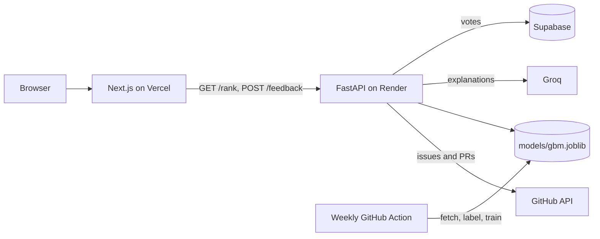

# Lysis

[](https://github.com/OpenRootdev/Lysis/actions/workflows/ci.yml)
[](LICENSE)

Beginner-friendly GitHub issue ranker. Give it a repo and it ranks the open issues by how likely a first-time contributor is to get a PR merged for them.

Labels like `good first issue` are often stale or wrong, so Lysis learns from what actually happened: issues that first-time contributors really closed.

**Live demo:** https://trylysis.me · [API docs](https://lysis-3ocq.onrender.com/docs) · [legacy Streamlit demo](https://mcx78yh52appm5botjqrh52.streamlit.app/)


## How it works

1. **Ingest:** fetch repos, issues and merged PRs from the GitHub API (ETag-cached).
2. **Label:** an issue is positive if a first-time contributor's PR closing it was merged. See [docs/labels.md](docs/labels.md).
3. **Model:** gradient boosting on issue and repo features, evaluated with repo-grouped cross-validation.
4. **Rank:** score open, unassigned issues, then decay by age so stale issues sink.
5. **Explain:** an LLM (Groq) writes a short note for the top 5. It never changes the ranking.


## Architecture



The frontend is a thin client. The API owns the model, the GitHub and Groq keys, and all database writes.

## API

| Endpoint | Description |
|---|---|
| `GET /rank?repo=owner/name&top=10&explain=true` | Ranked open issues, with short explanations for the top 5 |
| `GET /model` | Model metadata (training date, size, CV metrics, feature importance) |
| `POST /feedback` | Records a 👍/👎 on a recommendation |
| `GET /health` | Liveness check |

Rate limits: 30 `/rank` requests per IP per hour, with a global cap and a 10-minute response cache.

```bash
curl "https://lysis-3ocq.onrender.com/rank?repo=psf/requests&top=3"
```


## Results

5-fold repo-grouped CV on closed issues (base rate 0.10):

| Ranker | AP | AUC |
|---|---|---|
| Random | ~0.10 | 0.50 |
| Labels-only baseline | 0.195 | 0.746 |
| Gradient boosting | 0.26 | 0.795 |

Per language, AP against labels-only: Python 0.296 vs 0.223, JavaScript 0.169 vs 0.146.

This is an early prototype. The model beats the baseline, but the signal is modest.

## Quick start

```powershell
git clone https://github.com/OpenRootdev/Lysis.git
cd Lysis
python -m venv .venv
.venv\Scripts\activate          # macOS/Linux: source .venv/bin/activate
pip install -r requirements.txt
pip install -e .
copy .env.example .env          # macOS/Linux: cp .env.example .env
```

Edit `.env`:

| Variable | Required | Purpose |
|---|---|---|
| `GITHUB_TOKEN` | Yes | Read-only, public-repo token |
| `GROQ_API_KEY` | No | Enables issue explanations |

### Build the dataset

Run once. It takes a while, and responses are cached.

```powershell
python -m lysis.ingestion.fetch                        # Python (default)
python -m lysis.ingestion.fetch --language javascript
python -m lysis.features.labels
python -m lysis.models.evaluate
```

### Rank issues

```powershell
python -m lysis.cli psf/requests
python -m lysis.cli psf/requests 5 --explain
streamlit run src/lysis/app.py
```

```bash
uvicorn lysis.api:app --reload          # http://127.0.0.1:8000
cd web && npm install && npm run dev    # http://localhost:3000
```

Configuration (all optional for local use):

| Variable | Used by | Purpose |
|---|---|---|
| `GITHUB_TOKEN` | API, scripts | Read-only token for the GitHub API |
| `GROQ_API_KEY`, `GROQ_MODEL` | API | Explanations |
| `SUPABASE_URL`, `SUPABASE_ANON_KEY` | API | Feedback storage |
| `CORS_ORIGINS` | API | Comma-separated allowed frontend origins |
| `NEXT_PUBLIC_API_URL` | web | API base URL |

### API

```powershell
uvicorn lysis.api:app --reload      # docs at http://localhost:8000/docs
docker build -t lysis-api .
docker run -p 8000:8000 --env-file .env lysis-api
```

## Project layout

```
src/lysis/
  ingestion/   GitHub client and repo fetching
  features/    labels and feature building
  models/      baseline, gradient boosting, evaluation
  cli.py       command line ranking
  app.py       Streamlit UI
  api.py       FastAPI service
tests/
docs/
```

## Development

```powershell
ruff check .
pytest
```

CI runs both on every push and pull request. Changes to `main` go through a PR.

## Known limitations

- Trained on Python and JavaScript repos only.
- Labels depend on PRs linking issues with `closes #N`.
- A positive label means "a newcomer resolved it", which approximates beginner-friendly but is not the same thing.
- Issues no newcomer has attempted are never labeled positive.

## Contributing

See [CONTRIBUTING.md](CONTRIBUTING.md). Look for issues labeled `good first issue`.

## License

[MIT](LICENSE)
