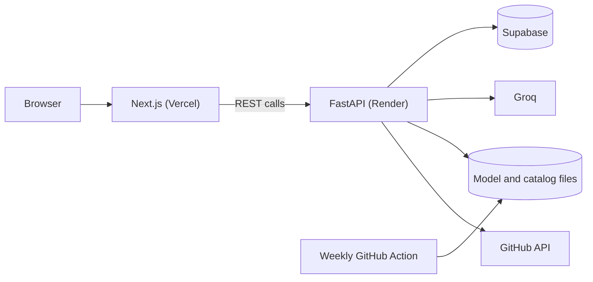

<a id="readme-top"></a>

<p align="center">
  <a href="https://trylysis.me">
    
  </a>

  <h3 align="center">Lysis</h3>

  <p align="center">
    Find the GitHub issues a beginner can actually finish.
    <br />
    <a href="https://trylysis.me"><strong>Live demo</strong></a>
    <br />
    <a href="https://github.com/OpenRootdev/Lysis/issues">Issues</a>
    &middot;
    <a href="./CONTRIBUTING.md">Contributing</a>
    &middot;
    <a href="./docs/labels.md">How labels work</a>
    &middot;
    <a href="#write-ups">Write-ups</a>
  </p>
</p>

<p align="center">
  <a href="LICENSE"></a>
  <a href="https://github.com/OpenRootdev/Lysis/actions/workflows/ci.yml"></a>
  <a href="https://github.com/OpenRootdev/Lysis/stargazers"></a>
  <a href="https://github.com/OpenRootdev/Lysis/pulse"></a>
  <a href="https://github.com/OpenRootdev/Lysis/issues?q=is:issue+is:open+label:%22good+first+issue%22"></a>
</p>

## About


Lysis ranks a repository's open issues by how likely it is that a first-time contributor gets a pull request merged for them.

I built it because the `good first issue` label has never been reliable. It is often missing, out of date, or sitting on something nobody actually wants help with. So Lysis doesn't trust the label. It looks at issues that were already closed, works out which ones a newcomer really resolved with a merged PR, and learns what those issues have in common.

You can paste any public `owner/repo` and get its issues ranked, or browse a catalog of about 1,900 repositories by language and experience level. It is free, MIT-licensed, and needs no account.

I also wrote up how it was built and tested, including what went wrong. See [Write-ups](#write-ups).

### Features

| | |
|---|---|
| **Issue ranking** | Open, unassigned issues for any public repo, scored and ordered, with age decay so stale issues sink. The top five get a short plain-language note on what the issue involves. |
| **Repo finder** | Pick a language and an experience level (Beginner, Intermediate, Advanced) to browse a scored catalog of repositories in six languages. |
| **Feedback** | A thumbs up or down on each recommendation, stored so the model can be checked against real opinions. |
| **Optional sign-in** | Sign in with GitHub to keep a private history of your searches and votes. The site works fully without it. |
| **Weekly refresh** | A GitHub Action refetches data, retrains the model, and rebuilds the catalog. |


### Built with

[Python](https://www.python.org/) and [scikit-learn](https://scikit-learn.org/) for the model, [FastAPI](https://fastapi.tiangolo.com/) for the API, [Next.js](https://nextjs.org/) and [Tailwind CSS](https://tailwindcss.com/) for the web app, [Supabase](https://supabase.com/) for feedback and sign-in, [Groq](https://groq.com/) for the explanations, [Docker](https://www.docker.com/) and [GitHub Actions](https://github.com/features/actions) for delivery, and [Playwright](https://playwright.dev/) for end-to-end tests.

## How it works

1. **Ingest.** Repositories, issues and merged PRs come from the GitHub API, cached with ETags and aware of rate limits.
2. **Label.** An issue counts as a success when a merged PR from a first-time contributor closes it. First-time means the author had no earlier commits in that repo. Details are in [docs/labels.md](docs/labels.md).
3. **Features.** Label flags (aliases such as `beginner` and `E-easy` are normalised), issue text size, author association, repo age, and counts of PRs merged before the issue was opened. Everything is measured as of the issue's creation date, so nothing leaks from the future.
4. **Model.** Gradient boosting, evaluated with 5-fold cross-validation grouped by repository, so a repo never appears in both training and test data.
5. **Rank.** Open issues are scored, then decayed by age.
6. **Explain.** An LLM writes a short note for the top five. It never changes the ranking.
7. **Refresh.** A weekly job refetches data, retrains, and rebuilds the repo catalog.


### Architecture



The frontend is a thin client. The API owns the model, the GitHub and Groq keys, and all feedback writes.

## Results

All numbers come from 5-fold cross-validation grouped by repository, over every closed issue in the dataset: 22,627 labeled issues, 4,646 of them first-timer successes (a base rate of 0.067).

| Ranker | AP | AUC |
|---|---|---|
| Random | 0.067 | 0.50 |
| Labels only | 0.176 | 0.706 |
| **Lysis** | **0.251** | **0.789** |

Average precision is about 43% higher than ranking by the `good first issue` label, and about 3.7 times random.

| Language | Lysis AP | Labels-only AP | Validated |
|---|---|---|---|
| Python | 0.301 | 0.225 | Yes |
| Go | 0.322 | 0.206 | Yes |
| TypeScript | 0.222 | 0.162 | Yes |
| Rust | 0.205 | 0.162 | Yes |
| Java | 0.170 | 0.131 | Yes |
| JavaScript | 0.190 | 0.191 | No (tie) |

A language is marked validated only if it has at least 500 issues and 30 positives, and the model beats the labels-only baseline on both AP and AUC. JavaScript ties on AP, so it isn't marked.

Several ideas were tried and removed because they didn't help: TF-IDF features from the issue text, repo PR-behaviour features, one model per language, and maintainer-response signals. The signal is real but modest. Lysis helps you pick a better handful of issues. It can't tell you which one will be merged.


## Getting started

### Prerequisites

- Python 3.13
- Node.js 22 (for the web app)
- A read-only GitHub token for public repositories
- Optional: a [Groq](https://console.groq.com) API key, and Docker

### Setup

```powershell
git clone https://github.com/OpenRootdev/Lysis.git
cd Lysis
python -m venv .venv
.venv\Scripts\activate          # macOS/Linux: source .venv/bin/activate
pip install -r requirements.txt
pip install -e .
copy .env.example .env          # macOS/Linux: cp .env.example .env
```

Add your `GITHUB_TOKEN` to `.env`. The other variables are listed under [Configuration](#configuration).

### Rank a repository

The repo includes a trained model, so this needs only a token:

```powershell
python -m lysis.cli psf/requests 5 --explain
```

To run the full stack locally:

```bash
uvicorn lysis.api:app --reload          # http://127.0.0.1:8000, docs at /docs
cd web && npm install && npm run dev    # http://localhost:3000
```

Put `NEXT_PUBLIC_API_URL=http://127.0.0.1:8000` in `web/.env.local`. A legacy Streamlit UI still works with `streamlit run src/lysis/app.py`.

### Rebuild the dataset

You only need this if you want to retrain. It takes a while, and responses are cached, so you can stop and resume.

```powershell
python -m lysis.ingestion.fetch --language all
python -m lysis.ingestion.fetch --language go --backfill-closed --limit 120
python -m lysis.features.labels
python -m lysis.models.evaluate     # cross-validation and per-language report
python -m lysis.models.train        # saves models/gbm.joblib
python -m lysis.catalog             # builds models/catalog.json
```

To add a language, add its name to `CATALOG_LANGUAGES` in `src/lysis/config.py`.

### Tests

```powershell
ruff check .
pytest
cd web && npm run lint && npm run build
```

CI runs the Python checks, the web lint and build, and a Docker build on every push and pull request. Changes to `main` go through a PR, and Dependabot keeps dependencies current.

## API

| Endpoint | Description |
|---|---|
| `GET /rank?repo=owner/name&top=10&explain=true` | Ranked open issues, with short notes for the top 5 |
| `GET /repos?language=python&level=beginner&top=20` | Scored repositories from the catalog |
| `GET /repos/meta` | Available languages, levels and catalog build info |
| `GET /model` | Training date, size, cross-validation metrics, feature importance |
| `POST /feedback` | Records a thumbs up or down on a recommendation |
| `GET /health` | Liveness check |

```bash
curl "https://lysis-3ocq.onrender.com/rank?repo=psf/requests&top=3"
```

## Deployment

**Docker.** The image runs as a non-root user, ships with the model and catalog, and reads secrets from the environment.

```powershell
docker build -t lysis-api .
docker run -p 8000:8000 --env-file .env lysis-api
```

Quotes in an `--env-file` are kept literally, so write `KEY=value` without them.

**API (Render).** Create a Web Service from the repository with the Docker runtime and add the run-time variables below. A free uptime monitor on `/health` every five minutes stops the free tier from sleeping.

**Web (Vercel).** Import the repository with the root directory set to `web` and set `NEXT_PUBLIC_API_URL`. Add the Vercel URL to `CORS_ORIGINS` on the API, comma-separated with no trailing slash. `NEXT_PUBLIC_` values are baked in at build time, so redeploy after changing one.

**Weekly refresh.** `.github/workflows/refresh.yml` refetches every language, retrains, and rebuilds the catalog. It needs a repository secret named `GH_READ_TOKEN` and uploads the new model and catalog as a workflow artifact, which you review and commit through a PR.

### Configuration

Run-time variables (API and scripts):

| Variable | Description | Required | Default |
| --- | --- | --- | --- |
| `GITHUB_TOKEN` | Read-only token for the GitHub API | Yes | |
| `GROQ_API_KEY` | Enables the issue notes | No | |
| `GROQ_MODEL` | Groq model id | No | `openai/gpt-oss-20b` |
| `SUPABASE_URL`, `SUPABASE_ANON_KEY` | Feedback storage | No | |
| `CORS_ORIGINS` | Allowed frontend origins, comma-separated | No | `http://localhost:3000` |
| `RATE_PER_IP` | `/rank` requests per IP per hour | No | `30` |
| `RATE_GLOBAL` | Cap on uncached ranking work per hour | No | `300` |
| `LYSIS_MAX_WAIT` | Seconds to wait out a GitHub rate limit before failing | No | `120` |

Build-time variables (web):

| Variable | Description | Required |
| --- | --- | --- |
| `NEXT_PUBLIC_API_URL` | API base URL, no trailing slash | Yes |
| `NEXT_PUBLIC_SUPABASE_URL`, `NEXT_PUBLIC_SUPABASE_ANON_KEY` | Optional GitHub sign-in | No |

### Troubleshooting

**`RateLimitError: Rate limited; reset in Ns`.** GitHub allows 5,000 authenticated requests an hour. Set `LYSIS_MAX_WAIT=3700` so long jobs wait instead of failing, then rerun. Progress is cached, so reruns resume where they stopped.

**The browser reports a CORS error.** `CORS_ORIGINS` must contain the exact origin of the site, with scheme and host and no trailing slash. Redeploy the API after changing it, and check that no old container is still answering on port 8000.

**The saved model won't load after an upgrade.** The model is a pickle tied to the scikit-learn version that trained it. Keep scikit-learn pinned, and retrain with `python -m lysis.models.train` after changing it.

**Notes show "n/a".** The Groq key is missing, or the default model name has been retired. Set `GROQ_MODEL` to a current id from the Groq console.

**The first request takes about a minute.** The free API tier sleeps when idle. An uptime monitor on `/health` avoids it.

**PowerShell blocks `Activate.ps1`.** Run `Set-ExecutionPolicy -Scope CurrentUser RemoteSigned` once, then activate again.

## Known limitations

- A positive label means "a newcomer resolved it". That approximates beginner-friendly, but it isn't the same thing.
- Labels only see merged successes. A beginner who tried and gave up, or whose PR was rejected, looks the same as an issue nobody touched.
- Repos that don't link issues in PRs with `closes #N` look as if they never welcome newcomers.
- Scores are for ranking only. They aren't probabilities, and they can't be compared across languages.
- JavaScript isn't validated, because the model only ties the label baseline there.
- The repo finder is a weekly snapshot. Ranking a repository you type in is live.
- The rate limiter keeps its counters in memory, so it resets on restart and applies per instance.

## Roadmap

Milestones are ordered by what they unlock. A milestone is done when its exit criterion is met, not when its checklist is ticked.

| Milestone | Theme | Status |
|---|---|---|
| **v0.1** | Working prototype | Shipped |
| **v0.2** | Measure | Next |
| **v0.3** | Harden | Planned |
| **v1.0** | Reach | Planned |

**v0.1: Working prototype**
- [x] Leak-free labels, features, and repo-grouped evaluation
- [x] Ranking API, web app, feedback, and LLM notes
- [x] Repo finder with languages and experience levels
- [x] Six languages with a validation rule
- [x] Weekly data, model, and catalog refresh

**v0.2: Measure.** Exit criterion: a published analysis of real user votes and a re-evaluated model.
- [ ] Analyse thumbs up and down votes against model scores
- [ ] Count "attempted but failed" first-timer PRs as their own outcome
- [ ] Per-language experience-level thresholds
- [ ] Per-issue score breakdown, showing which signals moved the score

**v0.3: Harden.** Exit criterion: a month of unattended weekly refreshes with no manual fixes.
- [ ] Shared-store rate limiter (Redis) for multiple instances
- [ ] Error tracking and a latency and uptime dashboard
- [ ] Automated model gate: a retrained model ships only if it beats the current one on a fixed test set
- [ ] Retire the legacy Streamlit UI

**v1.0: Reach.** Exit criterion: validated in at least eight languages and checked against real merge outcomes.
- [ ] More languages through the same catalog-only path (C#, PHP, Ruby, Kotlin)
- [ ] Track whether recommended issues actually got merged
- [ ] GitHub App that flags newcomer-friendly issues for maintainers
- [ ] Public dataset and evaluation script

See the [open issues](https://github.com/OpenRootdev/Lysis/issues) for the full list.

## Write-ups

- [I tested my ML model honestly. It beat good first issue labels by 43%](https://medium.com/@harshvora146/i-tested-my-ml-model-honestly-it-beat-good-first-issue-labels-by-43-1f19b9379302) on Medium
- [I tested my ML model honestly. It beat good issue labels by 43%](https://dev.to/harsh0641/i-tested-my-ml-model-honestly-it-beat-good-issue-labels-by-43-1n18) on DEV

They cover the mistakes along the way: an inflated first score, statistics from the future, and a rate-limit crash that produced the best-looking and least honest result.

## Contributing

Contributions of any size are welcome, whether it's a typo, a test, or a feature.

1. Read the [Contributing Guide](./CONTRIBUTING.md).
2. Run `ruff check .` and `pytest` before opening a PR, and put `Closes #N` in the description.
3. For model changes, include the numbers from `python -m lysis.models.evaluate`.

Issues labeled [good first issue](https://github.com/OpenRootdev/Lysis/issues?q=is:issue+is:open+label:%22good+first+issue%22) are small and well scoped, and a good place to learn the process.

<a href="https://github.com/OpenRootdev/Lysis/graphs/contributors">
  
</a>

## License

Released under the [MIT License](LICENSE).

## Contact

Questions, partnerships or private bug reports: [help@trylysis.me](mailto:help@trylysis.me). 
For anything about the code, please open a [GitHub issue](https://github.com/OpenRootdev/Lysis/issues) so the answer helps everyone.

## Acknowledgements

Thanks to [scikit-learn](https://scikit-learn.org), the [GitHub REST API](https://docs.github.com/rest), [Groq](https://groq.com), [Supabase](https://supabase.com), [Render](https://render.com) and [Vercel](https://vercel.com).
<p align="right">(<a href="#readme-top">back to top</a>)</p>